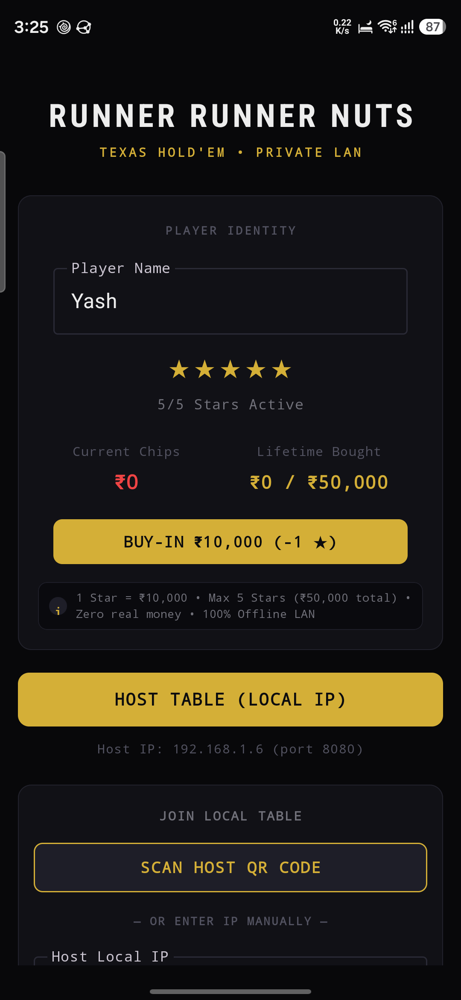
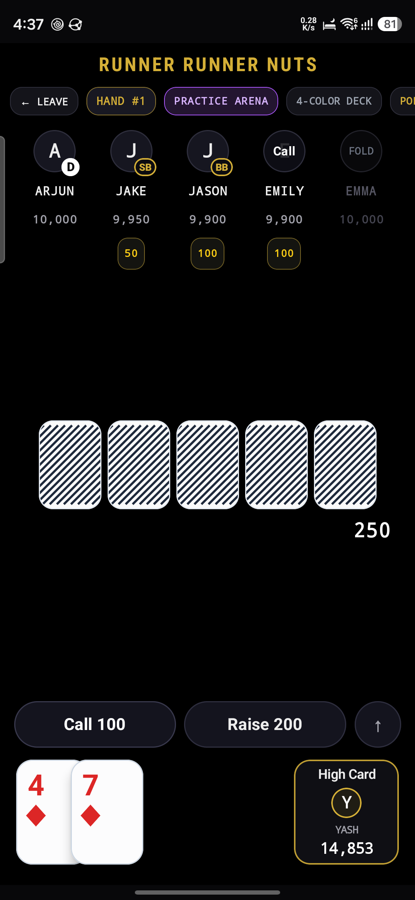
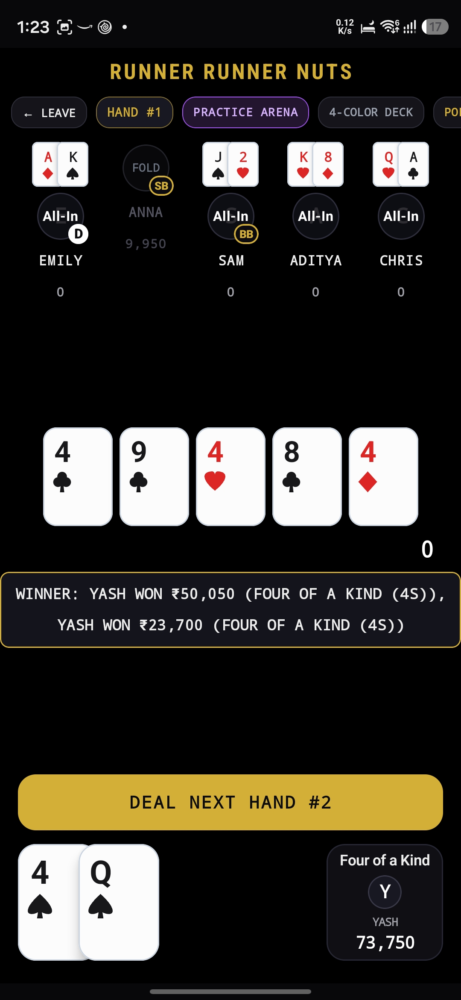
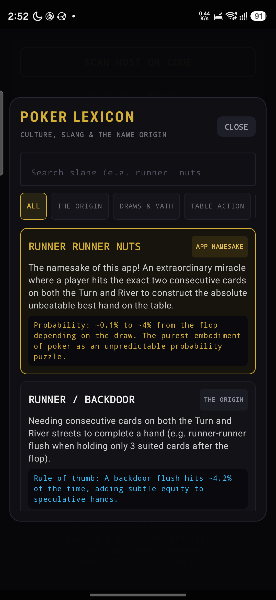

# Runner Runner Nuts

A modern, high-performance Texas Hold'em Poker application for Android, built from the ground up using **Jetpack Compose**, **Material 3**, and pure **Kotlin**.

Designed for an authentic, fluid poker experience with deep stack dynamics, multi-way pot resolution, and intuitive UI.

> ### ♠️ A Note from the Creator
> Full disclosure: **I am not a software developer — I’m just someone who genuinely loves poker.**
> 
> I built *Runner Runner Nuts* because I wanted a clean, distraction-free poker game that captures the real tension and psychology of the table, without the endless bingo-shoving, ads, and carnival gimmicks of typical mobile apps.
> 
> Because I'm learning as I go, please excuse any rough edges or imperfections in the code! If you love poker or Android dev, I would genuinely appreciate your feedback, bug reports, advice, and contributions to help make this app the best it can be.

---

## Screenshots

<p align="center">
  
  
  
  
</p>

---

## Features

- **Cross-Platform Local Multiplayer (iOS Safari & Web Support)**: Host a private table directly from your Android phone. Friends on iPhone, iPad, Mac, or PC can join and play instantly by scanning the table QR code with their camera or browsing to `http://<host-ip>:8080` in Safari/Chrome. Zero app download, zero cloud servers, zero ads—runs seamlessly over local Wi-Fi or a personal mobile hotspot via an embedded HTTP server and real-time WebSockets.
- **Custom Currency & Formats**: Play in USD (`$`), EUR (`€`), GBP (`£`), INR (`₹`), or type your own custom currency symbol with responsive formatting throughout the app.
- **Prestige Star Economy (High Stakes, Zero Real Money)**: Traditional free poker apps suffer from reckless "bingo poker" because play-money has no value. *Runner Runner Nuts* introduces a **Star Reputation System**: running out of chips requires sacrificing scarce, earned Stars to rebuy. This attaches genuine emotional weight and strategic consequence to every chip and fold—delivering authentic, high-tension poker psychology completely free from real-money gambling.
- **Practice Arena vs. Competitive Tables**: Offers a dedicated, risk-free Practice Arena with instant chip recovery to test strategies, alongside high-stakes tables where stack preservation and star management truly matter.
- **AMOLED Dark Theme**: Pure `#08080A` styling engineered for OLED displays and battery efficiency.
- **Smart Bot AI**: Opponents make mathematically sound decisions based on pot odds, hand equity, position, and texture, with realistic bet sizing.
- **Side Pot & All-In Engine**: Accurate multi-way pot resolution with comprehensive winner breakdowns (Main Pot vs. Side Pots).
- **Diagnostic Log Exporter**: In-app debug logging and one-click log export / clipboard sharing for troubleshooting.
- **Audio & Haptics**: Immersive sound effects for chip clicks, shuffles, card deals, and winning fanfares.
- **Pure Offline & Local Play**: Play anywhere without mandatory internet connectivity.

---

## Tech Stack & Architecture

- **Language**: Kotlin 2.0+
- **UI Framework**: Android Jetpack Compose with Material 3
- **Architecture**: MVI / StateFlow-driven unidirectional data flow
- **Build System**: Gradle Kotlin DSL (`build.gradle.kts`)
- **Compatibility**: Android 8.0 (API level 26) and above

---

## Building from Source

### Prerequisites
- Android Studio Ladybug / Meerkat (or newer)
- JDK 17 or JDK 21
- Android SDK 35

### Clone & Build
```bash
# Clone the repository
git clone https://github.com/Fezzotech/Runner-Runner-Nuts.git
cd Runner-Runner-Nuts

# Build debug APK
./gradlew assembleDebug

# Build release APK
./gradlew assembleRelease
```
The output APK will be generated at `app/build/outputs/apk/release/app-release.apk`.

---

## Contributing & Feedback

All contributions, poker strategy advice, and bug reports are warmly welcomed!

- **Found an issue or bug?** Export your diagnostic log directly from in-app settings and open an [Issue](https://github.com/Fezzotech/Runner-Runner-Nuts/issues).
- **Want to improve the code?** Feel free to submit a Pull Request—whether it's optimizing Jetpack Compose performance, refining bot hand ranges, or improving animations.
- **Have ideas for features?** Start a discussion or suggest ideas to help take the game to the next level.

---

## License

This project is open-source software licensed under the MIT License.
